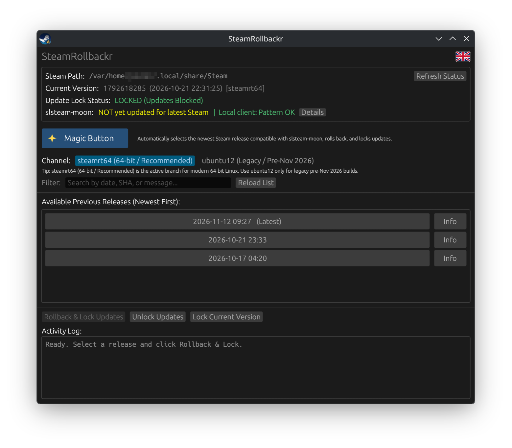

# SteamRollbackr

A Linux desktop tool to roll back the Steam client to an earlier version and lock or unlock automatic updates.

Works on most Linux distributions (Bazzite, SteamOS, Mint, Ubuntu, Fedora, Arch) and supports both native and Flatpak Steam installations.



## What It Does

- Checks `slssteam-moon` compatibility against the latest Steam client and displays a live status banner on **Home**.
- Shows your **System Status** (Local Steam Client Version, `slssteam-moon` pattern status, LuaTools, and Lumen) with direct project links.
- One-click **Rollback & Lock Steam** to roll back to the newest compatible Steam release and lock updates, or **Unlock & Update Steam** when `slssteam-moon` supports the latest client.
- **Advanced** tab for manual channel (`steamrt64` / `ubuntu12`) and release selection from [SteamTracking](https://github.com/SteamTracking/SteamTracking), manual lock/unlock controls, and custom **Steam Path** override.
- **Tools** tab to install or remove 32-bit `libcrypto.so.3` (`ubuntu12_32/`), LuaTools (`swwayps/luatools-moon`), and LuaTools (`mrpinkguy/luatools-linux`).
- **Troubleshooting** FAQ and **Logs** viewer, plus **Restart Steam** and **Refresh Status** sidebar actions (available in English, Portuguese, and Spanish).

## Installation

Download the package for your system from the [Releases](https://github.com/foodiemonster/SteamRollbackr/releases) page:

### AppImage (Recommended — SteamOS, Bazzite, and all distros)
1. Download `SteamRollbackr-<version>-x86_64.AppImage`.
2. Right-click the file -> **Properties** -> enable **Executable as Program** (or run `chmod +x SteamRollbackr-*-x86_64.AppImage`).
3. Double-click to launch.

### Debian / Ubuntu / Linux Mint (`.deb`)
Download `steamrollbackr_<version>_amd64.deb` and double-click it to install via your Software Center, or run:
```bash
sudo apt install ./steamrollbackr_*_amd64.deb
```

### Fedora / openSUSE (`.rpm`)
Download `steamrollbackr-<version>-1.x86_64.rpm` and double-click it to install via Software / Discover, or run:
```bash
sudo dnf install ./steamrollbackr-*.x86_64.rpm
```

### One-Line Installer (No Root Required)
```bash
curl -fsSL https://raw.githubusercontent.com/foodiemonster/SteamRollbackr/main/packaging/web-install.sh | bash
```

### Tarball
1. Download `steamrollbackr-linux-x86_64.tar.gz` from the [Releases](https://github.com/foodiemonster/SteamRollbackr/releases) page.
2. Extract and run the installer:

```bash
tar -xzf steamrollbackr-linux-x86_64.tar.gz
./install.sh
```

This installs the binary to `~/.local/bin/steamrollbackr`, the icon to `~/.local/share/icons/hicolor/256x256/apps/steamrollbackr.png`, and the desktop entry to `~/.local/share/applications/steamrollbackr.desktop`.

### Building from Source

```bash
cargo build --release
./install.sh
```

## Usage

1. Open **SteamRollbackr** from your application menu (or run `~/.local/bin/steamrollbackr`).
2. **Home (Recommended):**
   - Click **Rollback & Lock Steam** to automatically pick the newest Steam release compatible with `slssteam-moon`, roll back to it, and lock updates.
   - When the banner indicates the latest Steam version is compatible with `slssteam-moon`, click **Unlock & Update Steam** to remove the lock and update Steam.
3. **Advanced:** Override the detected Steam Path if needed, select a channel (`steamrt64` for modern 64-bit Linux, or `ubuntu12` for legacy pre-November 2026 builds), pick a specific release, and use **Rollback & Lock Updates**, **Unlock Only**, or **Lock Current Version**.
4. **Tools & Troubleshooting:** Install or remove helper fixes (`libcrypto.so.3`, LuaTools) and check the FAQ if anything needs attention.

## Uninstall

```bash
rm -f ~/.local/bin/steamrollbackr \
      ~/.local/share/applications/steamrollbackr.desktop \
      ~/.local/share/icons/hicolor/256x256/apps/steamrollbackr.png
```

If Steam updates are still locked and you want to re-enable them, click **Unlock Updates** before uninstalling (or run `chmod u+w` on your Steam `package/` folder and remove `Steam.cfg` and `steam.cfg`).

## License

MIT
